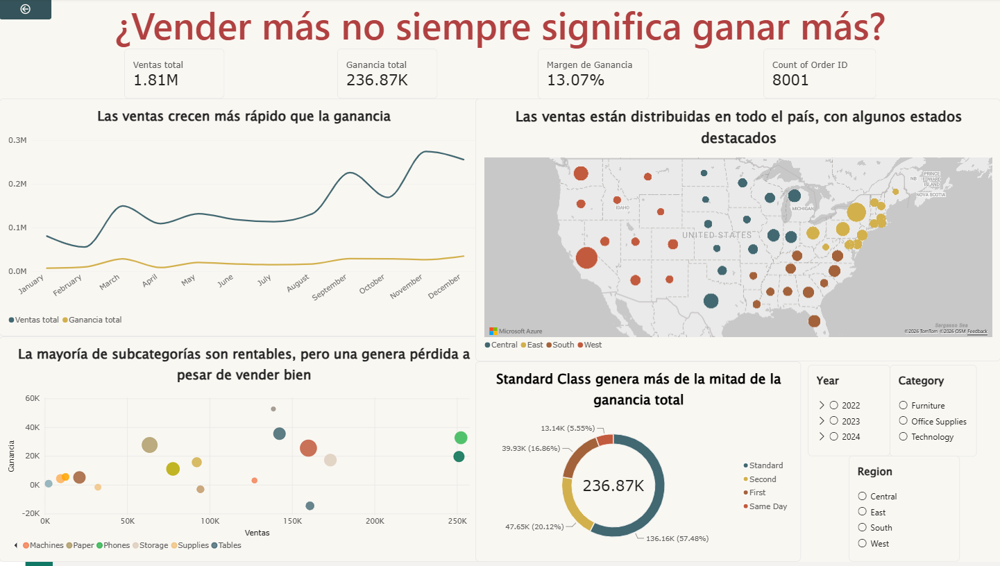

# Caso 1: ¿Vender más siempre significa ganar más?

Análisis de diagnóstico y perfilamiento de datos junto con un tablero interactivo en Power BI mediante un relato visual.

**Autora:** Daniela Mora Aguilar

## Pregunta de investigación

¿Vender más siempre implica ganar más? ¿Qué categorías, ubicaciones y modos de envío generan más ventas frente a lo que realmente se obtiene en ganancias?

## Herramientas

- Power BI Desktop
- Power Query (limpieza y transformación)
- DAX (medidas)

## Contenido del repositorio

| Archivo | Descripción |
|---|---|
| `Caso1_DanielaMora.pdf` | Informe del caso |
| `Caso1_DanielaMora.pbix` | Archivo de Power BI con el modelo y el dashboard |
| `datos/Dataset1.csv` | Datos originales (parte 1) |
| `datos/Dataset2.xlsx` | Datos originales (parte 2) |
| `imagenes/dashboard.png` | Captura del dashboard |

## Principales hallazgos

- Ventas totales: 1.81 M · Ganancia total: 236.87 K · Margen de ganancia: 13.07 %
- Las ventas mensuales oscilan entre 0.05 y 0.3 millones, mientras que las ganancias permanecen bajas de forma constante.
- Algunas subcategorías como Tables, Bookcases y Supplies generan ventas importantes pero pérdidas.
- El envío Standard es el más utilizado y el que aporta la mayor ganancia total (aprox. 57 %).
